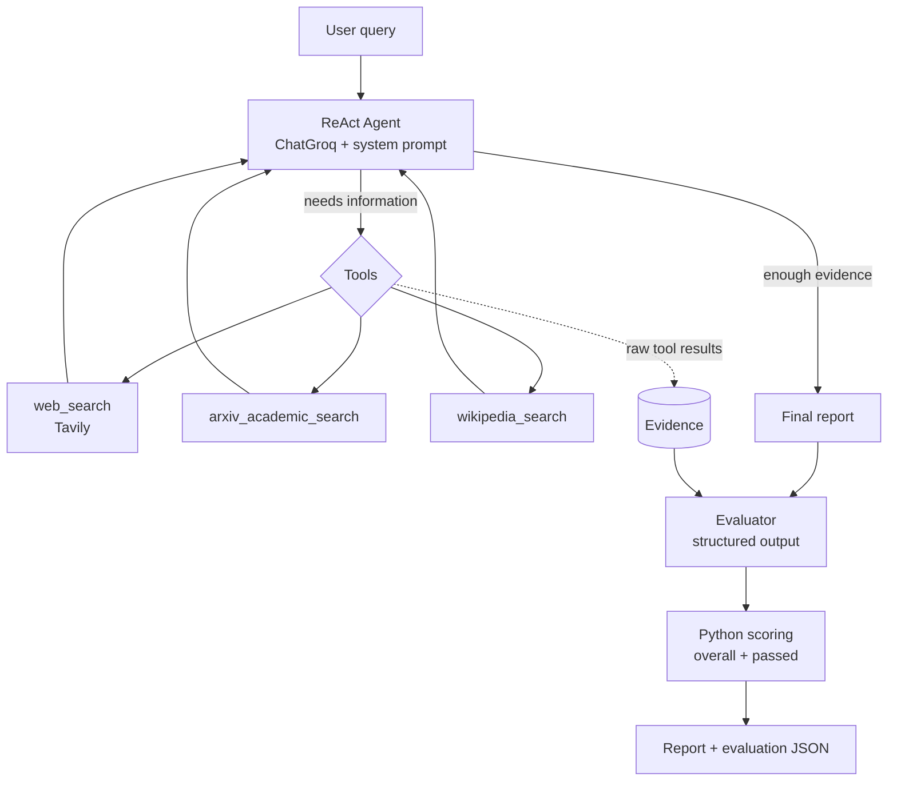

# Autonomous Research Agent with LangChain, LangGraph & Groq

An autonomous research agent that takes a question, decides which sources to consult (web, academic papers, encyclopedia), writes a structured report, and then **independently evaluates that report against the evidence it actually retrieved**.

Implemented in a single Jupyter/Colab notebook.

## Features

- **ReAct agent loop** (reason → act → observe → repeat) built with LangGraph's `create_react_agent`.
- **Three research tools**, each picked by the agent according to the information it needs:
  | Tool | Source | Best for |
  |---|---|---|
  | `web_search` | Tavily | Recent developments, news, benchmarks |
  | `arxiv_academic_search` | ArXiv | Scientific papers and preprints |
  | `wikipedia_search` | Wikipedia | Background, definitions, history |
- **Structured report format:** Executive Summary, Key Findings & Analysis, Supporting Evidence, References.
- **Independent report evaluator** that runs *after* the agent finishes (not as an agent tool), scores the report on relevance, evidence support, and completeness, and lists concrete issues and recommendations.
- **Deterministic scoring:** the LLM only produces the three sub-scores; the overall score and pass/fail are computed in Python.
- **Resilient runs:** tool errors are returned to the model instead of crashing the run, and rate limits / step limits are handled gracefully, keeping the evidence collected so far.

## How it works



### Evaluation design

The evaluator is deliberately **outside** the agent loop:

- The agent never has to repeat the full report inside a tool call, which saves output tokens.
- The agent does not choose its own evidence. The evaluator receives the real tool outputs, compacted per source (Tavily results reduced to title, URL, and snippet; each source truncated separately so no source is lost).
- Scores are computed in code:

```
overall = round(0.30 * relevance + 0.45 * evidence_support + 0.25 * completeness)
passed  = overall >= 80 and evidence_support >= 75 and relevance >= 70
```

Evidence support has the highest weight because the main failure mode of research agents is confident but unsupported claims.

## Tech stack

- Python 3, Jupyter / Google Colab
- [LangChain](https://python.langchain.com/) and [LangGraph](https://langchain-ai.github.io/langgraph/)
- [Groq](https://console.groq.com) via `langchain-groq` (default model: `openai/gpt-oss-120b`)
- [Tavily](https://tavily.com) search API
- ArXiv and Wikipedia via `langchain-community`
- Pydantic for structured evaluator output

## Getting started

### Prerequisites

- A free [Groq API key](https://console.groq.com)
- A [Tavily API key](https://tavily.com)

### Run on Google Colab (recommended)

1. Upload `research_agent.ipynb` to Colab.
2. Open the **Secrets** panel (🔑 icon) and add `GROQ_API_KEY` and `TAVILY_API_KEY`, then enable notebook access.
3. Run all cells from top to bottom.

If a secret is missing, the notebook prompts for it with a hidden input field. **Never paste API keys directly into the notebook.**

### Run locally

```bash
pip install -U langchain langchain-groq langchain-community langchain-tavily langgraph wikipedia "arxiv<4"
export GROQ_API_KEY="..."
export TAVILY_API_KEY="..."
jupyter notebook research_agent.ipynb
```

> `arxiv<4` is pinned because arxiv 4.x removed `Search.results()`, which LangChain's `ArxivAPIWrapper` still calls.

## Usage

```python
result = run_research("What are recent advances in Test-Time Compute and Reasoning Models?")

result["report"]       # final report (Markdown)
result["evidence"]     # list of (tool_name, raw_tool_output)
result["evaluation"]   # dict with scores, issues, recommendations, passed
```

Example evaluation output:

```json
{
  "overall_score": 81,
  "relevance_score": 95,
  "evidence_support_score": 70,
  "completeness_score": 85,
  "issues": ["..."],
  "recommendations": ["..."],
  "passed": false
}
```

Pass `evaluate=False` to skip the evaluation step.

## Configuration

| Setting | Where | Default | Purpose |
|---|---|---|---|
| `MODEL_NAME` | LLM cell | `openai/gpt-oss-120b` | Groq model to use |
| `reasoning_effort` | LLM cell | `"low"` | How much the model reasons before answering |
| `max_tokens` | LLM cell | `4096` | Output limit (reasoning tokens count toward it) |
| `MAX_STEPS` | Run cell | `40` | LangGraph recursion limit for the agent loop |
| `EVIDENCE_CHARS_PER_SOURCE` | Evaluator cell | `2000` | Per-source evidence truncation |
| `MAX_EVIDENCE_SOURCES` | Evaluator cell | `12` | Max tool results sent to the evaluator |
| `search_depth` | Tavily wrapper | `"basic"` | Cheaper searches; the model cannot override it |

## Design decisions

- **Tavily is wrapped in a custom tool that accepts only `query`.** Otherwise the model can pass extra parameters (for example `search_depth="advanced"`) that cost more credits or are invalid.
- **`ToolNode(handle_tool_errors=True)`** sends tool failures back to the model as messages, so it can retry or switch tools instead of crashing the run.
- **Strict citation rules in the system prompt:** use at least two different tools, cite only sources that appear in tool results, and never claim everything is verified.

## Known limitations

- **Hallucination is still possible.** In testing, an earlier prompt led the agent to cite references that were not in its tool results. The evaluator flagged it (low evidence-support score), which is why the evaluation step exists. The stricter prompt reduces, but does not eliminate, the risk. Always verify cited sources.
- **The judge is the same model as the writer**, which tends to score its own output generously. Using a different model for evaluation would be more objective.
- **Groq free tier has a daily token limit.** Long research runs can hit `RateLimitError`; the notebook reports it and keeps the evidence collected so far.
- `create_react_agent` is deprecated in LangGraph v1 in favor of `langchain.agents.create_agent`, and `langchain-community` is being sunset in favor of standalone integration packages.

## Roadmap

- [ ] Migrate to `langchain.agents.create_agent`
- [ ] Use a separate model for evaluation
- [ ] Automatic check that every URL / arXiv ID in the report appears in the retrieved evidence
- [ ] Revise-and-re-evaluate loop when `passed` is false
- [ ] Save reports and evaluations to disk (Markdown + JSON)

## Author

Ramez Fawzy Ragheb. [GitHub](https://github.com/ramezaboud)
